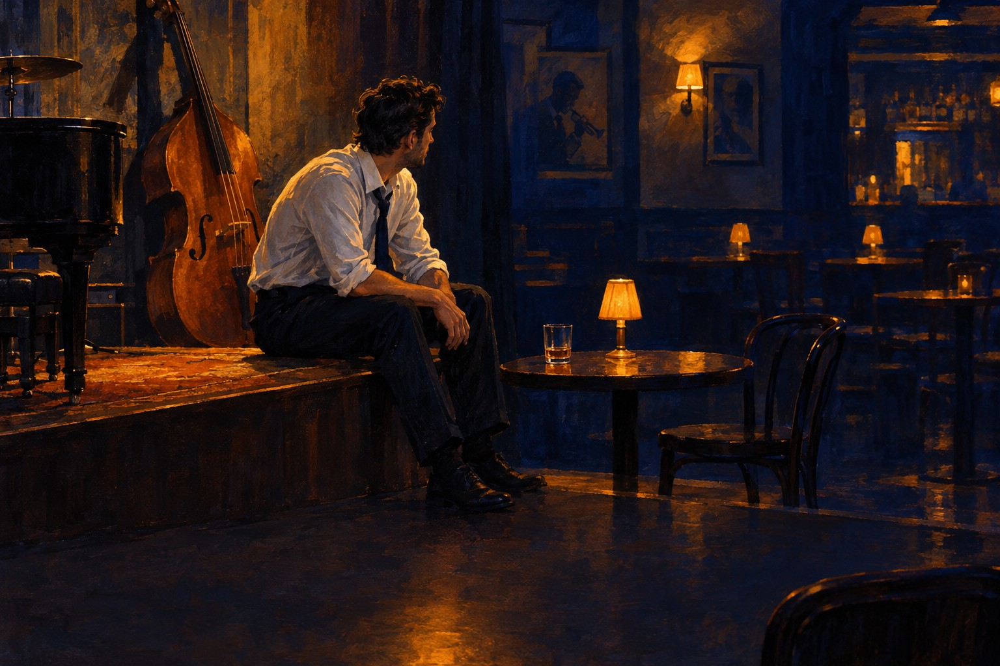

# 어른



> 어른인 척 해

어른 · 모르는 말에도 고개부터 끄덕이는 사람이 혼자 중얼거리는 노래다. 그러다 어릴 때 올려다본 어른들도 사실은 척하고 있었다는 걸 알게 된다.

## 이렇게 쓴 이유

'어른인 척 해'는 누구나 어제 한 번은 한 일이라서 설명 없이 바로 자기 얘기로 받힌다. 끝이 모음이라 스윙 위에서 늘여 부르기 좋고, 정해진 제목 '어른'이 후렴 첫머리에 그대로 선다. 1절은 지금의 나, 2절은 어릴 때 올려다본 어른들로 시점을 바꿨다. 같은 훅이 처음에는 자조로 들리고, 마지막 후렴에서는 누군가를 위해 버티는 말로 바뀐다. 자우림의 '~줄 알았던' 과거 기대를 현재와 부딪히는 원리와 잔나비의 '고백 직전에 자기를 낮추는 줄' 원리를 가져왔고, 마지막 후렴은 한로로처럼 한 줄만 바꿔 결론을 냈다. 제목은 요청대로 '어른'을 한 글자도 바꾸지 않은 단어 하나다.

참고한 곡

- 스물다섯, 스물하나 / 자우림: '~줄 알았던' 과거의 기대를 세우고 지금과 부딪히게 해서 설명 없이 시간을 보여 준다.
- 뜨거운 여름밤은 가고 남은 건 볼품없지만 / 잔나비: 고백하기 직전에 자기를 낮추는 줄을 놓고, 큰 감정어 옆에는 손에 잡히는 사물을 붙인다.
- 1111 / 한로로: 마지막 후렴은 한 줄만 바꿔서 같은 후렴이 다른 결론으로 들리게 한다.

조사 전체는 [research.md](research.md).

## 1. Suno에 붙여넣기

[Suno](https://suno.com/create)에서 Custom 모드를 켜고 아래를 칸마다 붙여넣는다. 곡 이미지는 cover.jpg.

**Style**
```text
Korean jazz pop, hard-swinging bebop small group, medium-up swing around 112 bpm, minor key opening into a bittersweet major chorus. Male baritone, warm, slightly husky, close to the mic, behind the beat, mature and sincere, sung in Korean, korean lyrics. Fat chewy upright bass up front, walking lines with ghost notes, slides, double stops, chromatic fills. Verse 1 whisper-quiet: bass, brushes, voice. Pre-chorus adds sparse piano comping. Chorus explodes: loud ride, punchy piano, sax and muted trumpet stabs answer the vocal, upward leap, long held note on the hook. Verse 2 drops back to quiet, busier bass fills. After chorus two: fast bebop piano solo, sax solo, trading fours, stop-time hits. Bridge near silence, bass and almost spoken voice, rubato. Final chorus loudest, shout horns, octave up. Sudden stop, final piano tension chord. Small jazz club, tape warmth. Wry, tender.
```

**Exclude styles**
```text
autotune, synth pads, scat singing
```

**Title**
```text
어른
```

**Lyrics**
```text
[Intro: upright bass alone, slow walking line]

[Verse 1: bass, brushes and voice only, whisper-quiet]
모르는 말 앞에서
먼저 끄덕이는 고개
얼굴은 다 아는 얼굴
책상 밑으로는
다리가 떨리는데
이런 건 금방 늘어
들키지 않을 만큼만

[Pre-Chorus: sparse piano comping enters, brushes build]
낮춘 목소리 하나
펴 둔 어깨 하나
문 열고 나가면

[Chorus: full band explodes, loud ride, horn stabs answer]
어른인 척 해
속은 아직 열한 살
어른인 척 해
아픈 건 집에 가서
어른인 척 해

[Verse 2: drops back to quiet, busier bass fills]
열한 살 내 눈에
올려다보던 그 어른들
뭐든 다 아는 줄 알았던
그 넓은 등도
책상 밑에서는
다리가 떨렸을까
들키지 않을 만큼만

[Pre-Chorus: piano comping, drums build]
낮춘 목소리 하나
펴 둔 어깨 하나
문 열고 나가면

[Chorus: full band explodes, loud ride, horn stabs answer]
어른인 척 해
속은 아직 열한 살
어른인 척 해
아픈 건 집에 가서
어른인 척 해

[Instrumental Break: bebop piano solo, tenor sax solo, trading fours, stop-time hits]

[Bridge: near silence, upright bass and close voice, rubato]
사실은 무서워
아는 건 아직 하나도 없고
그때 날 잡아 주던 손도
떨고 있었다면
나도 떨면서 잡을게

[Final Chorus: loudest, shout horns, octave up]
어른인 척 해
속은 아직 열한 살
어른인 척 해
누가 내 손 잡는 동안
어른인 척 해

[Outro: sudden stop, bass alone, final piano tension chord]
들키지 않을 만큼만

[End]
```

## 2. 곡 올리기

두 곡 중 마음에 드는 하나를 MP3로 받아 [이 폴더에 올리세요](https://github.com/kjhoeakjy/mufac/upload/main/songs/261030-10).
올리면 영상 만들기가 자동으로 시작됩니다. 진행은 [Actions](https://github.com/kjhoeakjy/mufac/actions)에서 봅니다.

가사 자막 위치가 틀리면 `timing.lrc`의 시간을 고치고 Actions에서 '영상 만들기'를 다시 실행하세요.

## 다른 후렴 후보

- 어른이 되면 (어른, 어릴 때 입버릇처럼 하던 '어른이 되면'을 서른 넘어 다시 떠올리는 사람이 부르는 느린 회상이다.)
- 다 큰 어른 (어른, 퇴근길 빈 놀이터 그네에 앉아 다리를 흔드는 사람을 지켜보는 밝은 관찰 노래다.)
- 어른도 울어 (어른, 화장실 칸에서 오 분 울고 나와 다시 자리에 앉는 사람에게 건네는 담담한 위로다.)
- 어른이라서 (어른, 하고 싶은 말을 삼키고 '어른이라서' 웃고 마는 오래된 친구 둘이 늦은 밤 나누는 말이다.)

이 중 하나로 쓰려면 '새 곡' 실행할 때 후렴 칸에 붙여넣으세요.
