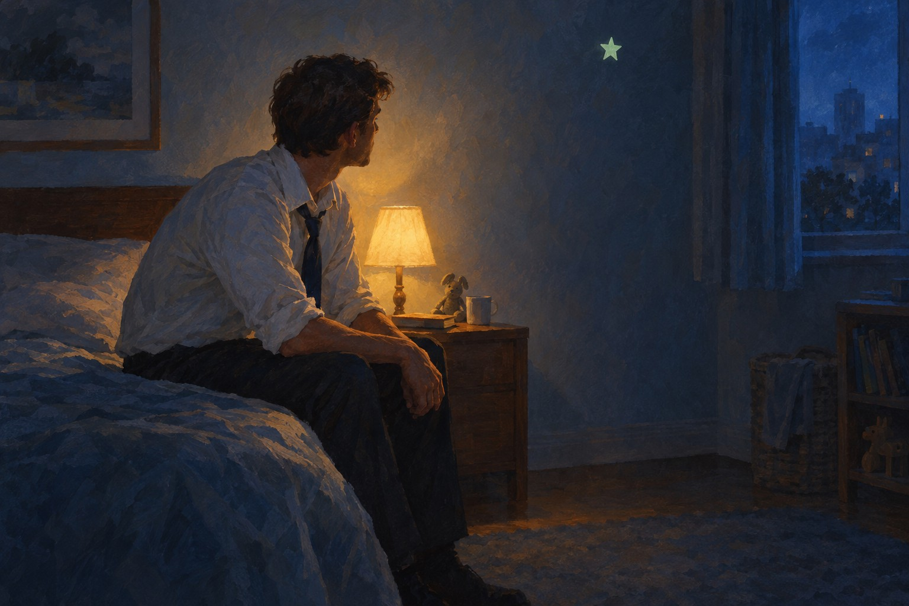

# 어린



> 아직 어린걸

어른 · 나이 오십이 넘어서도 불을 켜 놓고 자는 남자가 어른인 척 하루를 버티다가, 사실은 아직 어리다고 혼잣말처럼 털어놓는 밤에 부르는 노래.

## 이렇게 쓴 이유

'아직 어린걸'은 다섯 음절이고 'ㄹ' 받침으로 끝나서 길게 늘여 부르기 좋다. 무엇보다 어른이라면 거의 누구나 속으로 해 본 말이라 가장 넓게 닿는다. 자우림의 '~줄 알았어' 원리로 프리코러스에서 과거의 기대를 세우고, 절은 명사에서 끊어 몽환적인 느린 호흡을 만들었다. 잔나비처럼 고백 직전에 '키만 컸지 뭐'로 자기를 한 번 낮추고, 한로로처럼 마지막 후렴은 한 줄만 바꿔('불 하나 켜 두고'를 '네 불도 켜 둘게'로) 나를 지키던 말을 남을 지키는 말로 돌렸다. 제목은 정해진 '어린' 그대로 쓰고, 형태는 단어 하나로 분류했다. 훅 안에 이 낱말이 그대로 들어가 매 후렴마다 제목이 불린다.

참고한 곡

- 스물다섯, 스물하나 / 자우림: 명사·관형형에서 줄을 끊고 서술어를 생략해 느린 곡의 여백을 만든다.
- 이카루스 / 자우림: '~줄 알았어'로 과거의 기대를 세운 뒤 지금과 부딪혀 후렴으로 떨어뜨린다.
- 0+0 / 한로로: 마지막 후렴은 한 줄만 바꿔 결론을 내고, 무거운 말도 내일 약속으로 닫는다.
- 뜨거운 여름밤은 가고 남은 건 볼품없지만 / 잔나비: 고백 직전에 자기를 낮추는 자조 한 줄을 놓아 진심을 가볍게 받쳐 준다.

조사 전체는 [research.md](research.md).

## 1. Suno에 붙여넣기

[Suno](https://suno.com/create)에서 Custom 모드를 켜고 아래를 칸마다 붙여넣는다. 곡 이미지는 cover.jpg.

**Style**
```text
Korean indie rock, 2010s dreamy indie band sound, gentle 6/8 sway around 66 bpm, warm major key with a bittersweet minor turn. Male baritone in his fifties, low, weathered, slightly husky, murmured almost spoken verses, close dry vocal, behind the beat, sung in Korean, korean lyrics. Clean electric guitar arpeggios carry verse 1 over round picked bass and brushed live drums. Rhodes and a volume-swell guitar enter at the pre-chorus, rising. Chorus blooms: ride cymbal, wide ringing guitars, warm organ pad, cello and soft strings, stacked backing harmonies, long held low note on the hook. Glockenspiel from verse 2, strings fuller at the second chorus. Lead guitar answers the vocal in a short break. Bridge drops to Rhodes and spoken voice, rubato. Final chorus richest and widest, full strings, layered harmonies, drums open up. Outro on one guitar, slowing to a single chord. Small room, spring reverb, tape warmth. Dreamy, tender, weathered.
```

**Exclude styles**
```text
autotune, falsetto, synth lead
```

**Title**
```text
어린
```

**Lyrics**
```text
[Intro: clean guitar arpeggio, soft glockenspiel]

[Verse 1: one clean guitar, round bass on roots, brushed drums, low murmured vocal]
불 켜 놓고 자는 밤
이불은 목까지
아직 시험 꿈을 꿔
빈 답안지
아침엔 넥타이
거울 속 아저씨
눈은 그대로
키만 컸지 뭐

[Pre-Chorus: rhodes and second guitar swell in, rising]
어른이 되면
다 알 줄 알았는데

[Chorus: ride cymbal, warm organ pad, cello joins, soft backing harmonies]
아직 어린걸
아무도 모르게
아직 어린걸
불 하나 켜 두고
아직 어린걸

[Verse 2: glockenspiel doubles the guitar, melodic bass, murmured]
큰소리치던 부장도
혼자 탄 엘리베이터
한숨부터 쉬지
너도 알잖아
전화 받기 전에
목소리 고르는 거
나만 그런 거 아니지
키만 컸지 뭐

[Pre-Chorus: rhodes and second guitar swell in, rising]
다들 아는 얼굴로
하루를 버티는데

[Chorus: strings and organ fuller, stacked harmonies, wide guitars]
아직 어린걸
아무도 모르게
아직 어린걸
불 하나 켜 두고
아직 어린걸

[Instrumental Break: lead guitar answers the vocal melody]

[Bridge: drop to rhodes and voice, spoken, rubato]
사실은 나
지금도 무서워
현관 앞에 선 아침
그래도 나가
문은 열어 두고

[Final Chorus: full band, full strings, layered harmonies, richest]
아직 어린걸
아무도 모르게
아직 어린걸
네 불도 켜 둘게
아직 어린걸
(아직 어린걸)

[Outro: one guitar and glockenspiel, slowing down]
잘 자
내일 또 크자

[End]
```

## 2. 곡 올리기

두 곡 중 마음에 드는 하나를 MP3로 받아 [이 폴더에 올리세요](https://github.com/kjhoeakjy/mufac/upload/main/songs/261031-2).
올리면 영상 만들기가 자동으로 시작됩니다. 진행은 [Actions](https://github.com/kjhoeakjy/mufac/actions)에서 봅니다.

가사 자막 위치가 틀리면 `timing.lrc`의 시간을 고치고 Actions에서 '영상 만들기'를 다시 실행하세요.

## 다른 후렴 후보

- 다들 어린 (어른, 큰소리치던 사람들이 혼자 있을 때 작아지는 모습을 지켜보는 사람이 중간 템포로 담담하게 부른다.)
- 어린 내가 보면 (아픔, 어릴 때 되고 싶던 어른과 지금의 나 사이에서, 지나고 보니 별것 아니었던 일을 털어 내는 회상.)
- 우린 어린데 (사랑, 결혼, 집, 다음 단계 이야기 앞에서 아직 준비가 안 된 연인이 서로에게 털어놓는 느린 고백.)
- 어린 밤 (어른, 친구들과 늦게까지 놀며 잠깐 열 살로 돌아간 밤을 밝게 부르는 노래.)

이 중 하나로 쓰려면 '새 곡' 실행할 때 후렴 칸에 붙여넣으세요.
