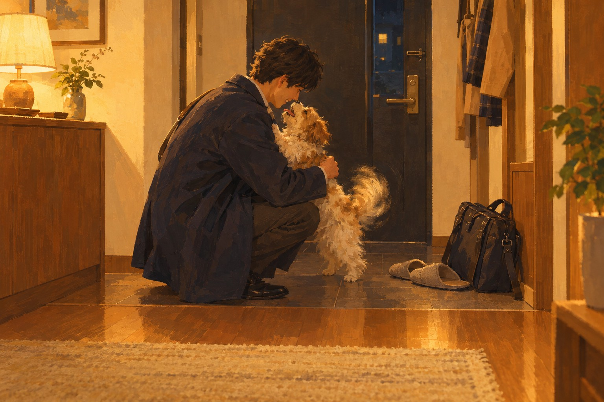

# 멍멍!



> 멍멍! 그거면 돼

어른 · 아무도 수고했다 안 한 날, 문 앞에서 짖는 소리 하나로 하루를 덮는 사람이 강아지에게 부르는 노래.

## 이렇게 쓴 이유

집에 와서 반겨 주는 존재 하나면 하루가 정리되는 기분은 반려인이 아니어도 누구나 아는 것이라 0번이 가장 넓다. 제목 '멍멍!'을 그대로 훅 머리에 두고 '그거면 돼'를 붙여 모음으로 늘여 부를 수 있게 했고, 후렴은 한 문장 되풀이로만 짰다. 극동아시아타이거즈처럼 그리움을 하찮은 생활 사물(발톱 소리, 한쪽 귀)에서 꺼냈고, 한로로처럼 마지막 후렴에서 한 줄만 바꿔 결론을 냈다(털 묻은 바지라도 → 나도 멍멍 해 줄게). 브릿지에서 처음으로 '기다린 건 나'라는 진심과 '보고 싶었어'를 직접 말해, 같은 훅이 끝에서 다르게 들리게 했다. 제목은 지정이라 그대로 두었고 형태는 단어 하나다.

참고한 곡

- 모기 / 극동아시아타이거즈: 큰 감정을 하찮고 정확한 생활 장면(발톱 소리, 한쪽 귀)에서 꺼낸다.
- 사랑하게 될 거야 / 한로로: 후렴은 짧은 한 문장으로 되풀이하고 마지막 후렴에서 한 줄만 바꿔 결론을 낸다.
- 스물다섯, 스물하나 / 자우림: 명사와 관형형에서 줄을 끊고 서술어를 다음 줄로 넘겨 짧게 간다.

조사 전체는 [research.md](research.md).

## 유튜브

- 본편 https://youtu.be/DhZTOUD6qTM
- 쇼츠 https://youtube.com/shorts/hiMsjDjmfrc
- 비공개로 올라갑니다. [YouTube Studio](https://studio.youtube.com)에서 공개로 바꾸세요.

## 1. Suno에 붙여넣기

[Suno](https://suno.com/create)에서 Custom 모드를 켜고 아래를 칸마다 붙여넣는다. 곡 이미지는 cover.jpg.

**Style**
```text
Korean acoustic pop, bouncy 2010s sound, around 100 bpm, bright major key. Male tenor vocal, light, clear and close, a smile in the tone, little vibrato, relaxed just behind the beat, mature and sincere, sung in Korean, korean lyrics. Strummed capo acoustic guitar opens with a short whistle motif. Verse 1: guitar and round acoustic bass on roots, narrow talky melody. Pre-chorus: cajon enters in sixteenths with a fingerpicked second guitar, rising on a repeated note. Chorus: handclaps, light piano, doubled vocal with third harmony, upward leap on the first word, long held last note of the hook. Verse 2 adds shaker and guitar fills answering the voice. Whistle break after chorus two. Bridge strips to one guitar and soft, almost spoken voice. Final chorus warmest and fullest, whistle answers the hook, ends on one bright strum. Living room sound, dry and warm, string noise audible. Sunny, playful, tender.
```

**Exclude styles**
```text
distorted electric guitar, synth pads, autotune
```

**Title**
```text
멍멍!
```

**Lyrics**
```text
[Intro: strummed acoustic guitar, short whistle motif]

[Verse 1: guitar and acoustic bass only, close voice]
오늘 내 이름은
메일 끝에만 있었어
계단 다 오르기 전에
문 너머 발톱 소리
바닥에 미끄러지는
온몸이 꼬리인 애
열쇠도 아직인데
벌써 거기 서 있지

[Pre-Chorus: cajon enters, second guitar, rising]
뭘 했냐고 안 묻고
늦은 건 잊은 얼굴
문이 열리기만 하면

[Chorus: handclaps, light piano, doubled vocals]
멍멍! 그거면 돼
나머진 다 문밖에
멍멍! 그거면 돼
털 묻은 바지라도
멍멍! 그거면 돼

[Verse 2: shaker added, guitar answers the voice]
신발 신는 소리에
등 돌리고 눕는 애
금방 온다는 말은
오늘도 안 먹히네
닫히는 문틈으로
한쪽 귀만 이쪽으로
나도 안 가고 싶어
닫힌 문에 한 말

[Pre-Chorus: cajon sixteenths, rising]
뭘 했냐고 안 묻고
늦은 건 잊은 얼굴
문이 열리기만 하면

[Chorus: handclaps, light piano, doubled vocals]
멍멍! 그거면 돼
나머진 다 문밖에
멍멍! 그거면 돼
털 묻은 바지라도
멍멍! 그거면 돼

[Instrumental Break: whistle and guitar]

[Bridge: one guitar and voice, soft, almost spoken]
하루 종일 기다린 건
너인 줄 알았는데
사진 속 네 얼굴에
실실 웃는 건 나
보고 싶었어

[Final Chorus: full band, third harmony, whistle answers the hook]
멍멍! 그거면 돼
나머진 다 문밖에
멍멍! 그거면 돼
나도 멍멍 해 줄게
멍멍! 그거면 돼

[Outro: guitar alone, last bright strum]
산책 갈래

[End]
```

## 2. 곡 올리기

두 곡 중 마음에 드는 하나를 MP3로 받아 [이 폴더에 올리세요](https://github.com/kjhoeakjy/mufac/upload/main/songs/261031-6).
올리면 영상 만들기가 자동으로 시작됩니다. 진행은 [Actions](https://github.com/kjhoeakjy/mufac/actions)에서 봅니다.

가사 자막 위치가 틀리면 `timing.lrc`의 시간을 고치고 Actions에서 '영상 만들기'를 다시 실행하세요.

## 다른 후렴 후보

- 멍멍! 나 왔어 (사랑, 현관을 열며 강아지와 같은 말로 인사를 주고받는 사람이 중얼거리는 노래.)
- 멍멍! 산책 가자 (사랑, 주말 아침 줄을 꺼내기만 해도 날뛰는 강아지에게 같이 나가자고 부르는 밝은 노래.)
- 멍멍! 다 알아 (아픔, 울고 들어온 밤, 아무것도 묻지 않고 옆에 붙어 앉는 강아지에게 부르는 느린 노래.)
- 멍멍! 금방 와 (어른, 출근하는 아침마다 등 돌리고 삐친 강아지에게 미안해하며 나서는 사람의 노래.)

이 중 하나로 쓰려면 '새 곡' 실행할 때 후렴 칸에 붙여넣으세요.
