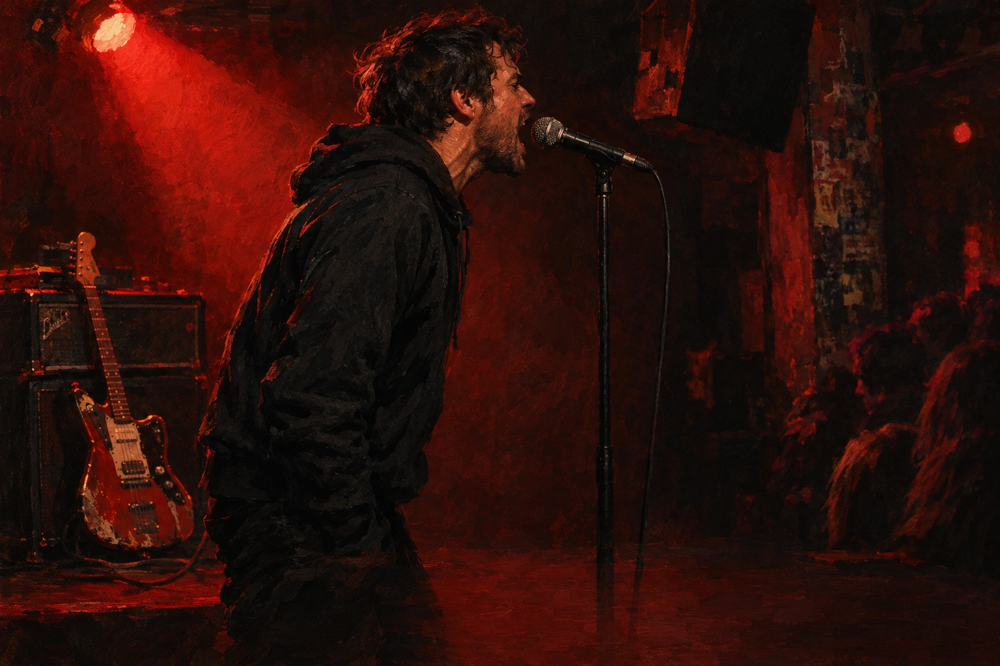

# 작두



> 네가 작두냐

어른 · 남의 팔자를 다 안다는 듯 떠드는 사람에게, 늘 듣기만 하던 사람이 처음으로 소리 지르며 되묻는다.

## 이렇게 쓴 이유

'네가 작두냐'는 명절 어른, 직장 상사, 훈수 두는 선배처럼 누구에게나 있는 '다 아는 듯 떠드는 사람'에게 그대로 던질 수 있어 가장 넓게 공감된다. 크라잉넛 '말달리자'의 원리대로 외침 앞에 모순과 선언을 쌓아 두고, 상황극 없이 '팔자'와 '칼'이라는 뜻만 남겨 누구나 자기 사람을 꽂아 넣게 했다. 극동아시아타이거즈처럼 마지막 후렴에서 '네가'를 '나도'로 한 글자 바꿔 칼끝이 나에게 돌아오게 했고, 브릿지에서 처음으로 나도 그랬다고 고백해 그 변화를 받친다. 한로로식으로 소리가 닮은 말을 한 줄에 붙여 '날 위에서 날을 바꿔'(칼날/하루)로 2절의 시간 변화를 보여 준다. 제목은 지정된 '작두' 한 단어 그대로이며, 훅 안의 낱말로 후렴마다 세 번 불린다.

참고한 곡

- 말달리자 / 크라잉넛: 외침 하나를 터뜨리기 전에 그 앞에 말을 쌓아 두어야 외침이 소음이 아니라 응답이 된다.
- 그대에게 / 무한궤도: 질주하는 템포 위에서 제목이 곧 후렴이 되어 곡 전체를 끌고 간다.
- 다시, 다시 만나 / 극동아시아타이거즈: 마지막 후렴에서 핵심 낱말 하나만 바꿔 같은 훅을 다른 뜻으로 들리게 한다.
- 불시 / 터치드: 후렴 가사를 한 글자만 바꿔 화자가 달라졌음을 보여 준다.

조사 전체는 [research.md](research.md).

## 1. Suno에 붙여넣기

[Suno](https://suno.com/create)에서 Custom 모드를 켜고 아래를 칸마다 붙여넣는다. 곡 이미지는 cover.jpg.

**Style**
```text
Korean rock, 2000s garage punk edge, fast 152 bpm, driving straight eighths, minor key power chords. Male lead, raspy chest voice, shouted and furious, talky clipped verses right on the beat, screamed hook, sung in Korean, korean lyrics. Intro: one distorted guitar riff alone, then live drums and picked bass slam in. Verse 1: palm-muted riff, closed hi-hat, bass locked to the kick, narrow shouted melody. Pre-chorus: toms, rising repeated note, guitars open. Chorus: two distorted guitars left and right, open crash, fat snare, upward leap on the first word, short clipped hook, gang vocals shout the hook back. Verse 2 adds a lead guitar answering the voice. Noisy 8-bar guitar solo. Bridge: half-time, bass and near-spoken voice. Final chorus loudest, octave-up shout, hard stop. Live room drums, raw and loud. Angry, defiant, cathartic.
```

**Exclude styles**
```text
autotune, synth pop beat, string orchestra
```

**Title**
```text
작두
```

**Lyrics**
```text
[Intro: one distorted guitar riff alone, then drums and bass slam in]

[Verse 1: palm-muted riff, closed hi-hat, shouted talky delivery]
보지도 않고 다 봤다며
틀릴수록 더 크게 말해
남의 팔자 위에서
맨발로 춤을 추네

[Pre-Chorus: toms, rising repeated note, guitars open]
지랄 마 지랄 마
피는 내가 흘리는데

[Chorus: wall of guitars, open crash, gang vocals on the hook]
네가 작두냐
씨발 네가 작두냐
내 팔자에 칼 대지 마
네가 작두냐

[Verse 2: lead guitar answers the voice]
어제는 망한다더니
오늘은 될 줄 알았대
날 위에서 날을 바꿔
맨발로 춤을 추네

[Pre-Chorus: toms, rising repeated note, guitars open]
지랄 마 지랄 마
피는 내가 흘리는데

[Chorus: wall of guitars, open crash, gang vocals on the hook]
네가 작두냐
씨발 네가 작두냐
내 팔자에 칼 대지 마
네가 작두냐

[Guitar Solo: noisy 8 bars, then sudden stop]

[Bridge: half-time, bass and near-spoken voice]
나도 남의 팔자에
칼을 댄 밤이 있어

[Final Chorus: loudest, octave-up shout, gang vocals]
네가 작두냐
씨발 나도 작두냐
남의 팔자에 칼 대지 마
네가 작두냐

[Outro: riff once more, hard stop]

[End]
```

## 2. 곡 올리기

두 곡 중 마음에 드는 하나를 MP3로 받아 [이 폴더에 올리세요](https://github.com/kjhoeakjy/mufac/upload/main/songs/261101-6).
올리면 영상 만들기가 자동으로 시작됩니다. 진행은 [Actions](https://github.com/kjhoeakjy/mufac/actions)에서 봅니다.

가사 자막 위치가 틀리면 `timing.lrc`의 시간을 고치고 Actions에서 '영상 만들기'를 다시 실행하세요.

## 다른 후렴 후보

- 작두 위에서 (아픔, 하루하루 칼날 위에서 버티면서도 아무렇지 않은 얼굴로 사는 사람이 자기 자신에게 부르는 노래.)
- 작두를 타 (어른, 출근하는 모두가 매일 칼날 위에서 춤추는 신세라는 것을 같이 겪는 사람들이 함께 외친다.)
- 우리 끝을 점치지 마 (사랑, 시작도 하기 전에 끝을 단정하는 연인에게, 아직 끝나지 않았다고 맞서는 사람.)
- 칼날은 내가 타 (어른, 훈수 두는 사람들을 등지고 내 팔자는 내가 걸겠다고 버티는 사람.)

이 중 하나로 쓰려면 '새 곡' 실행할 때 후렴 칸에 붙여넣으세요.
