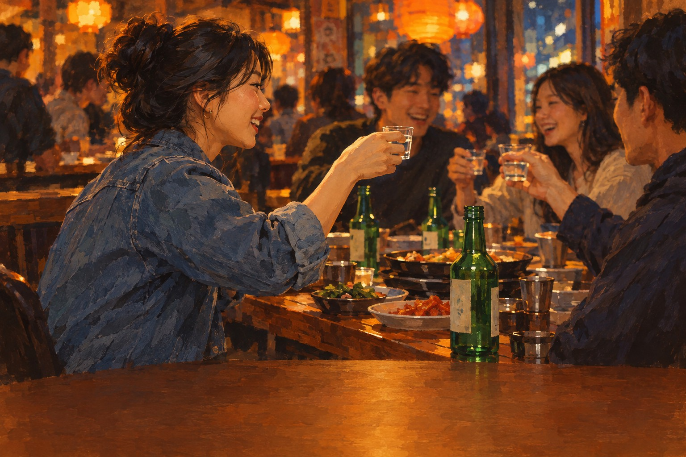

# 나는 연주야



> 나는 연주야

사랑 · 처음 만난 술자리에서 낯을 가리던 연주가 이름부터 크게 말하며 합주하자고 먼저 손을 내미는 노래.

## 이렇게 쓴 이유

제목이 '나는 연주야'로 정해져 있으니 훅은 제목 그대로여야 하고, 소개곡은 이름이 가장 많이 들려야 남는다. 크라잉넛 '말달리자'처럼 입으로 외칠 수 있는 한 덩이 말을 후렴 첫 줄과 셋째 줄에 세우고, 사용자가 정한 '술 한번 먹자 나 소주 좋아해'를 그 사이에 넣어 이름-부탁-이름-인사로 닫았다. 주어 대명사로 시작하는 줄 제한은 지정 제목 때문에 후렴에서만 예외로 두고, 절은 주어 없이 짧은 뜻으로만 썼다. 마지막 후렴은 한로로처럼 한 줄만 바꿔 '만나서 반가워'를 '이제 이름 불러 줘'로 돌려, 브릿지의 '낯선 사람으로 헤어지기 싫어'를 지나온 뒤 같은 훅이 부탁으로 들리게 했다. 화법은 직전 두 곡(너에게, 혼잣말)을 피해 처음 만난 '우리'의 말로 잡았다.

참고한 곡

- 말달리자 / 크라잉넛: 제목을 입으로 외칠 수 있는 한 덩이 말로 두고 후렴에서 되풀이하면 처음 듣는 사람도 두 번째 후렴에서 따라 부른다.
- 사랑하게 될 거야 / 한로로: 마지막 후렴은 한 줄만 바꿔 결론을 내고, 짧은 부탁형으로 닫는다.
- 다시, 다시 만나 / 극동아시아타이거즈: 2절은 1절의 틀을 지키고 마지막 한 줄을 리프레인으로 고정해, 같은 말이 시점이 바뀐 뒤 다르게 들리게 한다.

조사 전체는 [research.md](research.md).

## 1. Suno에 붙여넣기

[Suno](https://suno.com/create)에서 Custom 모드를 켜고 아래를 칸마다 붙여넣는다. 곡 이미지는 cover.jpg.

**Style**
```text
Korean band pop rock, 2010s indie band sound, 96 bpm, straight eighth-note groove, warm major key, minor turn at the bridge. Bass-driven, bass loud and upfront. Melodic picked electric bass riff opens alone, returns between vocal lines, fat fills answer the voice, walks up in the pre-chorus, bass riff break after chorus two. Female alto, low warm chest voice, smooth and clean, plain delivery, little vibrato, sung in Korean, korean lyrics. Live drums in a small room, punchy kick, crisp snare. One crunchy rhythm guitar, lead guitar only in choruses. Chorus hits hard: full band, crash cymbals, upward leap on the first word, strong chest voice, doubled vocal, third harmony from chorus two. Bridge: half-time, bass and voice only. Final chorus: biggest. Outro: bass riff twice, hard stop. Warm, bold, honest.
```

**Exclude styles**
```text
trot, autotune, raspy vocal
```

**Title**
```text
나는 연주야
```

**Lyrics**
```text
[Intro: loud solo bass riff, then drums and guitar join]

[Verse 1: loud bass riff leads, hi-hat, one clean guitar]
나는 연주야
나랑 합주할래
처음 보는데 낯설지 않아
이름이면 충분해

[Pre-Chorus: tom build, bass walks up]
첫인사는 늘 서툰데
다시 크게 말할게

[Chorus: full band hits hard, crash cymbals, heavy bass, doubled vocals]
나는 연주야
술 한번 먹자
소주가 좋아
베이스가 좋아
나랑 합주할래
나는 연주야

[Verse 2: fat bass fills answer the voice]
궁금한 네 이름
들으면 꼭 외울게
모르는 사람끼리
이름이면 충분해

[Pre-Chorus: tom build, bass walks up]
첫인사는 늘 서툰데
다시 크게 말할게

[Chorus: full band hits hard, heavy bass, third harmony]
나는 연주야
술 한번 먹자
소주가 좋아
베이스가 좋아
나랑 합주할래
나는 연주야

[Bass Solo]

[Bridge: half-time, bass and voice only]
낯선 사람으로
헤어지기 싫어

[Final Chorus: biggest, bass loudest, third harmony]
나는 연주야
술 한번 먹자
소주가 좋아
베이스가 좋아
나랑 합주할래
이제 이름 불러 줘

[Outro: bass riff twice, hard stop]
만나서 반가워
나는 연주야

[End]
```

## 2. 곡 올리기

두 곡 중 마음에 드는 하나를 MP3로 받아 [이 폴더에 올리세요](https://github.com/kjhoeakjy/mufac/upload/main/songs/261101-8).
올리면 영상 만들기가 자동으로 시작됩니다. 진행은 [Actions](https://github.com/kjhoeakjy/mufac/actions)에서 봅니다.

가사 자막 위치가 틀리면 `timing.lrc`의 시간을 고치고 Actions에서 '영상 만들기'를 다시 실행하세요.

## 다른 후렴 후보

- 만나서 반가워 (어른, 새로 모인 사람들 사이에서 어색함을 털고 반가움을 바로 말하는 중간 템포의 인사)
- 소주 좋아해 (어른, 긴 하루 끝에 처음 본 사람에게 꾸밈없이 취향부터 털어놓는 담담한 밴드곡)
- 이름 불러 줘 (사랑, 낯선 사람으로 헤어지기 싫어서 이름을 기억해 달라고 조용히 고백하는 느린 곡)
- 술 한번 먹자 (아픔, 한동안 혼자였던 사람이 다시 사람을 만나러 나가며 건네는 가벼운 첫마디)

이 중 하나로 쓰려면 '새 곡' 실행할 때 후렴 칸에 붙여넣으세요.
