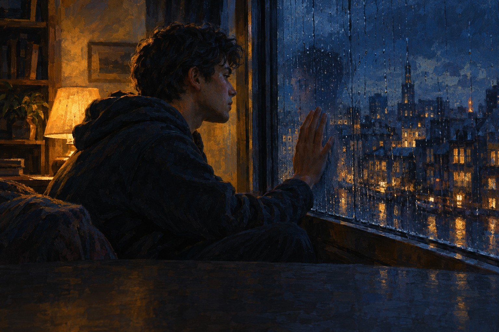

# One Glimpse of You



> One Glimpse of You

아픔 · 다 잊었다고 말하고 다니던 사람이 스치듯 본 한순간에 1년의 노력이 무너지는 걸 느끼며 그 사람에게 부르는 노래.

## 이렇게 쓴 이유

'One glimpse of you'는 열린 모음 you로 끝나서 길게 늘여 부를 수 있고, 세 번 불러도 어색하지 않습니다. 이별 뒤 '괜찮다'고 말해 본 사람이라면 누구나 자기 일로 받아들일 수 있습니다. 레퍼런스 노트 초안의 빗속 신호등, 택시, 지명 같은 장면 소품은 모두 걷어내고 '한순간에 무너지는 회복'이라는 마음만 남겼습니다. 제목과 훅을 같은 짧은 말로 맞추는 원칙은 No Scrubs와 Say My Name에서, 작은 편곡으로 시작해 하모니로 부풀리는 전개는 Best Part에서 가져왔습니다. 마지막 후렴에서는 'all it took'을 'I'd give it all for'로 바꿔, 같은 훅이 원망에서 갈망으로 뒤집혀 들리게 했습니다.

참고한 곡

- No Scrubs / TLC: 제목과 훅을 같은 짧은 말로 맞추고, 후렴을 바로 선언으로 시작합니다.
- Say My Name / Destiny's Child: 절에 질문을 두어 의심과 추궁을 대화처럼 들리게 합니다.
- Best Part / Daniel Caesar & H.E.R.: 작은 편곡으로 소박하게 시작해 하모니로 부풀리는 전개입니다.
- Adorn / Miguel: 가슴소리와 가성을 오가되, 가성은 가장 진심인 자리에 아껴 씁니다.
- Ordinary People / John Legend: 화자가 솔직하게 털어놓고, 후렴은 낮게 시작해 천천히 오르게 합니다.

조사 전체는 [research.md](research.md).

## 유튜브

- 본편 https://youtu.be/FkpVEB8PPEM
- 쇼츠 도입 https://youtube.com/shorts/pwGQEatmWPg
- 쇼츠 후렴 https://youtube.com/shorts/CtXUcKLEjuI
- 쇼츠 브릿지 https://youtube.com/shorts/4uONRZEhMtY
- 쇼츠 엔딩 https://youtube.com/shorts/g1NexBsPrKw
- 비공개로 올라갑니다. [YouTube Studio](https://studio.youtube.com)에서 공개로 바꾸세요.

## 1. Suno에 붙여넣기

[Suno](https://suno.com/create)에서 Custom 모드를 켜고 아래를 칸마다 붙여넣는다. 곡 이미지는 cover.jpg.

**Style**
```text
R&B, 2010s neo soul, around 86 bpm, minor key with warm maj7 and m9 chords. Smooth male tenor, breathy and close, relaxed behind the beat, one falsetto line in the bridge, sung in English, english lyrics, native English pronunciation. Intro: clean tremolo electric guitar chords and finger snaps. Verse 1: half beat, soft kick, synth bass on long notes, narrow syncopated melody. Pre-chorus: 16th hi-hats with ghost notes enter, rising repeated note. Chorus: full beat, crisp snare behind the beat, upward leap on the first word, long held last word, stacked harmonies. Verse 2 adds muted guitar strokes answering the voice. Guitar and pad interlude. Bridge: beat drops to guitar and voice. Final chorus widest, ad-libs, bass slides. Outro: guitar loop fading. Close dry lead vocal, wide backing vocals, warm analog. Late night, aching, tender.
```

**Exclude styles**
```text
autotune, distorted guitar, rap verse
```

**Title**
```text
One Glimpse of You
```

**Lyrics**
```text
[Intro: tremolo guitar and finger snaps]

[Verse 1: half beat, synth bass, close voice]
I told the world that I was done with you,
And for a while I swore that it was true,
Then one look and you were almost mine,
And I felt all of it one more time

[Pre-Chorus: hi-hats enter, rising]
It wasn't even a second long,
But it was long enough to know

[Chorus: full beat, stacked harmonies]
One glimpse of you and I'm not fine,
A whole year of letting go, undone,
'Cause I still want you, I can't lie,
And all it took was one glimpse of you

[Verse 2: muted guitar answers the voice]
Did you even know that it was me?
Or am I just a face you used to see?
I keep tellin' everyone I'm good,
And I'd believe me too, if I could

[Pre-Chorus: hi-hats enter, rising]
It wasn't even a second long,
But it was long enough to know

[Chorus: full beat, stacked harmonies]
One glimpse of you and I'm not fine,
A whole year of letting go, undone,
'Cause I still want you, I can't lie,
And all it took was one glimpse of you

[Instrumental: guitar and pad interlude]

[Bridge: beat drops, guitar and falsetto]
Truth is I was never gone at all,
I just learned to live with half my soul

[Final Chorus: widest harmonies, ad-libs]
One glimpse of you and I'm not fine,
And I don't even wanna run,
'Cause I still want you, I can't lie,
Now I'd give it all for one glimpse of you

[Outro: guitar loop fading]

[End]
```

## 2. 곡 올리기

두 곡 중 마음에 드는 하나를 MP3로 받아 [이 폴더에 올리세요](https://github.com/kjhoeakjy/mufac/upload/main/songs/261102-2).
올리면 영상 만들기가 자동으로 시작됩니다. 진행은 [Actions](https://github.com/kjhoeakjy/mufac/actions)에서 봅니다.

가사 자막 위치가 틀리면 `timing.lrc`의 시간을 고치고 Actions에서 '영상 만들기'를 다시 실행하세요.

## 다른 후렴 후보

- Just a Glimpse Is Enough (사랑, 막 사랑에 빠진 사람이 상대를 잠깐 보는 것만으로 하루가 채워진다고 고백하는 노래.)
- Don't Look at Me Like That (사랑, 끝내야 할 관계인데 상대의 한 번의 눈길에 마음이 다시 흔들리는 사람이 그만해 달라고 부탁하는 노래.)
- Let Me See You Again (아픔, 떠난 사람을 꿈에서만 잠깐 보는 사람이 한 번만 더 보게 해 달라고 비는 노래.)
- All I Got Was a Glimpse (어른, 돌아보니 젊은 날도 가장 좋았던 사람도 잠깐 스쳐 지나갔을 뿐이라는 걸 깨달은 어른의 혼잣말.)

이 중 하나로 쓰려면 '새 곡' 실행할 때 후렴 칸에 붙여넣으세요.
